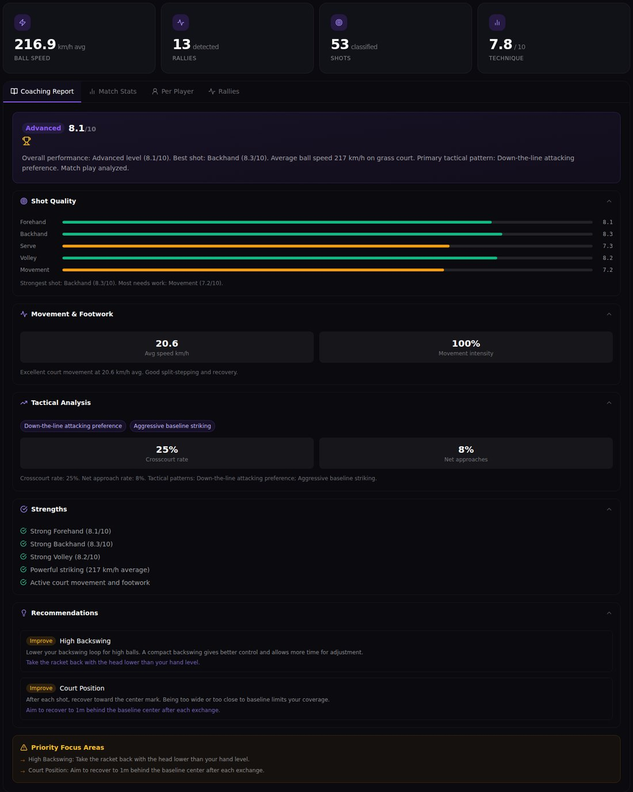
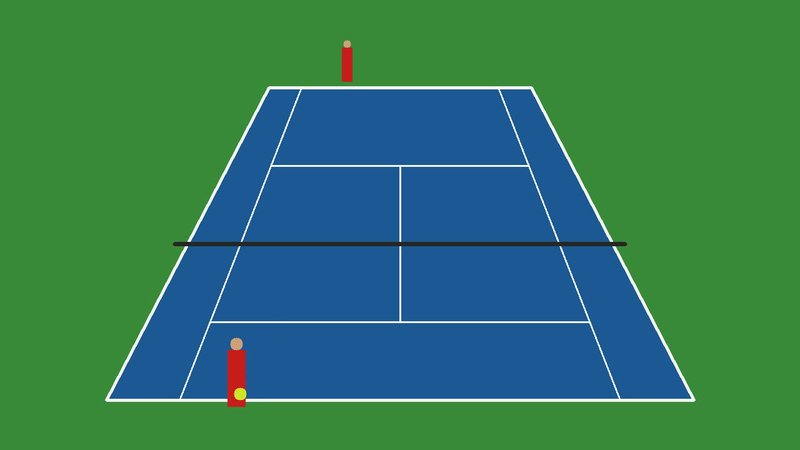
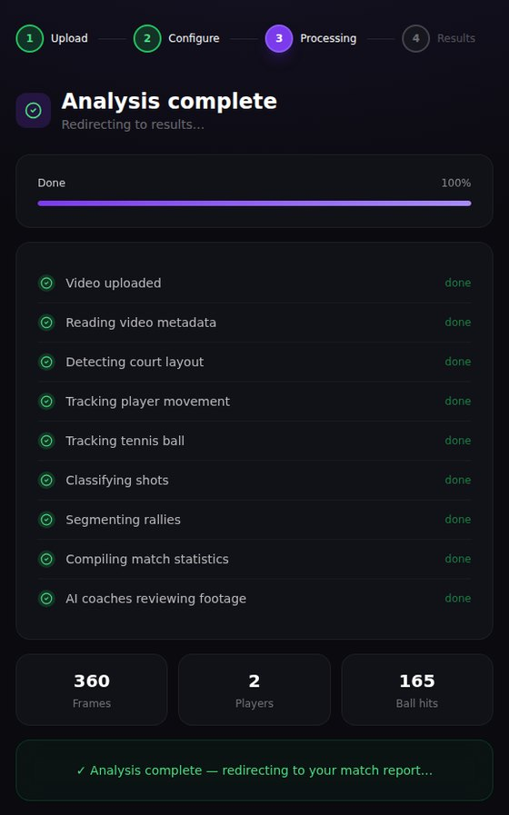
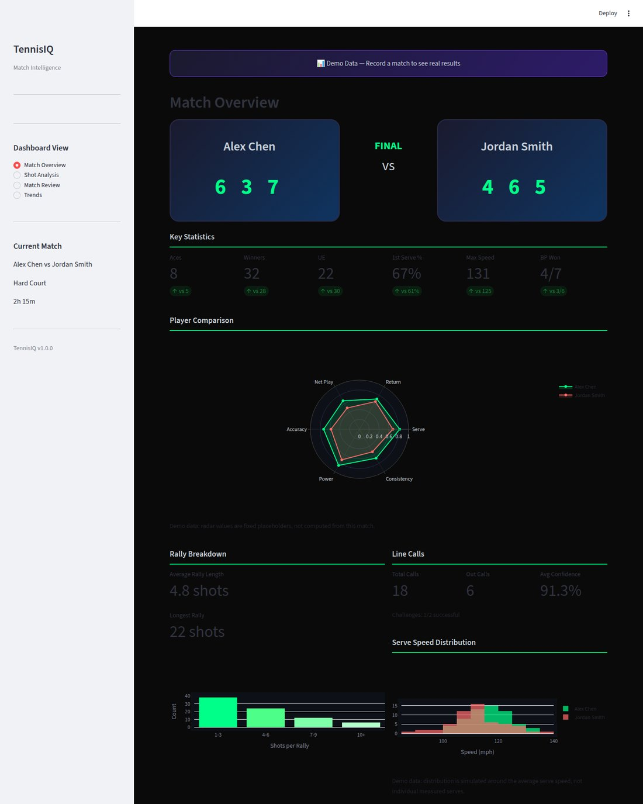
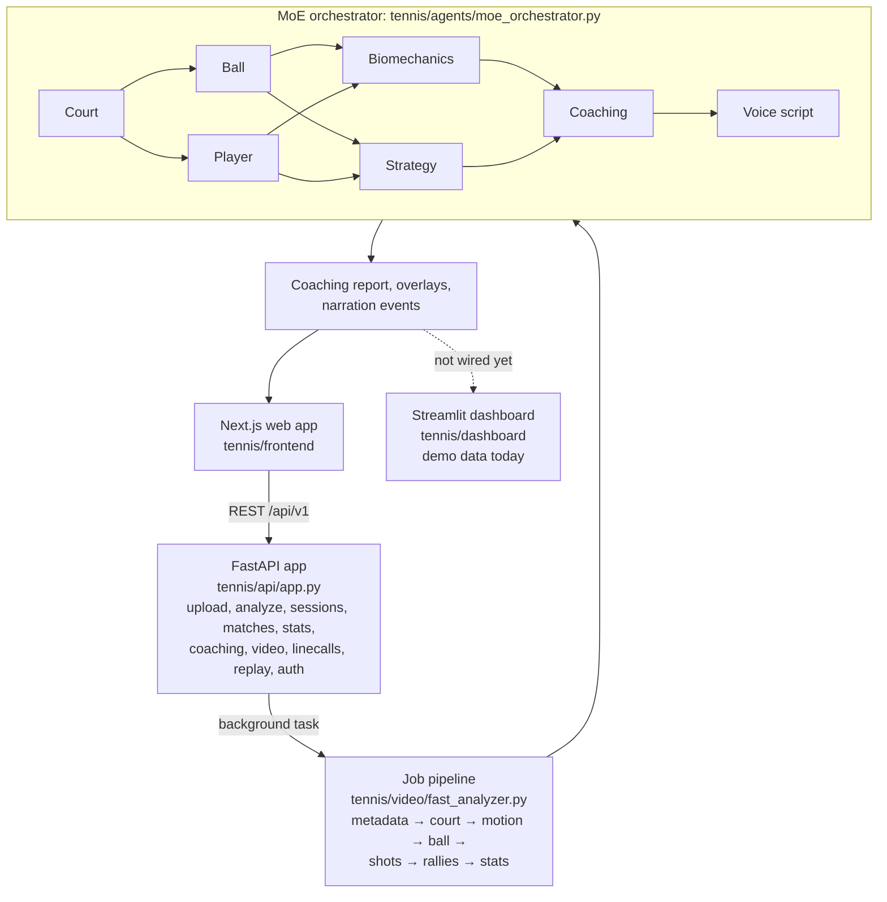

# TennisIQ: AI Tennis Swing & Match Analyzer

**Upload a single-camera tennis video and get court, ball and player detection, rally and shot stats, and a structured coaching report from a pipeline of specialist agents, served by FastAPI with a Next.js web app and a Streamlit dashboard.**

[](https://github.com/Akshatb848/AI-Tennis-Swing-Analyzer/actions/workflows/tennisiq-ci.yml)
[](LICENSE)




<sub>Captured with headless Chromium from the Next.js app and the FastAPI backend running locally. The input was a
12-second **synthetic** clip drawn by <code>scripts/make_demo_clip.py</code> (frame below), not real match footage.
Every number is what the current heuristic pipeline produced for that clip; it shows the end-to-end flow working,
not accuracy. For example, the blue hard court was reported as "grass" and the cartoon players' ball speed as 217 km/h.
See <a href="#current-status--limitations">limitations</a>.</sub>

| Input (synthetic clip frame) | Pipeline progress (real job, stage by stage) |
|---|---|
|  |  |

<details>
<summary><b>Streamlit analytics dashboard</b> (runs on labelled demo data)</summary>



The dashboard is not yet wired to the API's analysis results, so it shows generated sample data under a "Demo Data" banner.
</details>

---

## Key features

- **Video upload and analysis jobs.** `POST /api/v1/upload/`, then `POST /api/v1/analyze`, then poll for stage-by-stage progress until results, coaching, overlays and a narration script are ready.
- **Court, ball and player detection** with OpenCV: HSV colour segmentation, Hough lines and circles, frame differencing and contours.
- **Shot classification, rally segmentation and match stats** derived from detected motion and ball activity.
- **Mixture-of-Experts coaching pipeline.** Specialist agents add findings to a shared context in dependency order, and one agent failing does not stop the others. The pipeline ends in a structured coaching report and timed narration events.
- **Domain engines:** tennis scoring, line calling, event processing, stats, post-match review and recording.
- **Clients:** Next.js web app (upload → configure → processing → results), Streamlit analytics dashboard, and a SwiftUI iOS/watchOS scaffold.

## Architecture



| Agent | Role (as implemented) |
|-------|-----------------------|
| `court_agent.py` | Court boundaries, net, baseline and service boxes from HSV segmentation + Hough lines |
| `ball_agent.py` | Ball detection (yellow-green HSV mask + HoughCircles), trajectories, speed and bounce estimates |
| `player_agent.py` | Player detection with contours / background subtraction, position and movement tracking |
| `biomechanics_agent.py` | Swing and technique issues from motion intensity and position data, with frame annotations |
| `strategy_agent.py` | Shot placement zones, rally patterns, court positioning |
| `coaching_agent.py` | Combines expert outputs into a prioritised coaching report |
| `voice_agent.py` | Timed narration script from templates (played in the browser with the Web Speech API) |
| `moe_orchestrator.py` | Runs agents in dependency order; failures are isolated per agent (`_safe_run`) |

Other packages: `tennis/engine/` (scoring, line calling, events, stats, shot classifier, review), `tennis/ml/` (frame analyzer, detectors, inference pipeline, model *specs*), `tennis/video/` (capture, frame buffer, overlays, highlights, avatar renderer), `tennis/models/` (Pydantic models), `tennis/infra/` (Docker, Nginx, Prometheus config, SQLite `SessionStore`).

## Tech stack

| Area | Tools |
|---|---|
| Backend | Python, FastAPI, Uvicorn, Pydantic v2 / pydantic-settings, PyJWT |
| Vision | OpenCV 4.x (headless), NumPy |
| Dashboard | Streamlit, Plotly, pandas |
| Frontend | Next.js 14, React 18, TypeScript, Tailwind CSS, TanStack Query, Zustand, Recharts |
| Mobile | Swift / SwiftUI scaffold (iOS + watchOS sources) |
| Infra | Docker, docker-compose, Nginx, Prometheus config |
| Quality | pytest (151 tests), Ruff, GitHub Actions (Python 3.10/3.11/3.12 matrix) |

## Quick start

Run from the repository root.

### 1. Backend API

```bash
python3.11 -m venv .venv && source .venv/bin/activate
pip install fastapi "uvicorn[standard]" pydantic pydantic-settings python-multipart \
            httpx numpy pandas plotly "opencv-python-headless>=4.8,<5" PyJWT google-auth aiofiles \
            streamlit pytest
cp .env.example .env          # optional; defaults work for local use
uvicorn tennis.api.app:app --port 8000
```

API docs at http://localhost:8000/docs, health check at http://localhost:8000/health.

The root `requirements.txt` also installs the dependencies of the legacy code (xgboost, lightgbm, chromadb, psycopg2, ...; see [below](#note-on-root-level-legacy-code)). It works but is heavier than TennisIQ needs. Keep OpenCV on 4.x: OpenCV 5 changed the Hough transform output shapes and the detection code fails with it.

### 2. Web app

```bash
cd tennis/frontend
npm install
NEXT_PUBLIC_API_URL=http://localhost:8000 npm run dev    # http://localhost:3000
```

### 3. Try it without real footage

```bash
python scripts/make_demo_clip.py demo_clip.mp4 --seconds 12
```

Upload `demo_clip.mp4` at http://localhost:3000/upload. This is how the screenshots above were made.

### 4. Streamlit dashboard

```bash
streamlit run tennis/dashboard/tennis_dashboard.py      # http://localhost:8501
```

### 5. Docker (backend stack)

```bash
docker compose -f tennis/infra/docker-compose.yml up --build
```

Builds the API and dashboard from `tennis/infra/Dockerfile` and starts Postgres, Redis and Nginx next to them. The current API keeps its state in memory and does not use Postgres or Redis yet.

## Configuration

Settings are read by `tennis/config.py` from the environment or a `.env` file. See [`.env.example`](.env.example) for the full list. The ones that matter:

| Variable | Purpose | Default |
|---|---|---|
| `JWT_SECRET` | Signs auth tokens. **Change outside local dev.** | dev placeholder |
| `ENVIRONMENT` | `development` / `staging` / `production` | `development` |
| `CORS_ORIGINS` | Allowed origins (JSON list) | `["*"]` |
| `UPLOAD_DIR`, `VIDEO_UPLOAD_DIR`, `VIDEO_OUTPUT_DIR` | Where uploads and outputs go | `./uploads...`, `./output/tennisiq` |
| `GOOGLE_CLIENT_ID` | Google sign-in | empty |
| `NEXT_PUBLIC_API_URL` | Frontend → API base URL (set for `npm run dev`) | `http://localhost:8000` |

## Testing

```bash
pip install pytest pytest-asyncio
ruff check tennis/
python -m pytest -q tennis/tests
```

The 151 tests in `tennis/tests/` cover scoring, event processing, stats, coaching, line calling, recording, review, the ML pipeline, the real-time pipeline, the avatar renderer, the API (FastAPI `TestClient`) and a smoke test that renders the Streamlit dashboard. CI (`.github/workflows/tennisiq-ci.yml`) runs Ruff and the suite on Python 3.10, 3.11 and 3.12, and on `main` builds and pushes the API image to GHCR. A separate workflow (`test.yml`) runs the legacy root-level tests.

## Project structure

```
.
├── tennis/                 ← TennisIQ (the product)
│   ├── agents/             MoE agents + orchestrator
│   ├── api/                FastAPI app, routes, middleware
│   ├── engine/             scoring, line calling, stats, coaching, review
│   ├── ml/                 frame analyzer, detectors, inference pipeline, model specs
│   ├── video/              analysis job pipeline, capture, overlays, highlights
│   ├── models/             Pydantic domain models
│   ├── dashboard/          Streamlit dashboard + data provider
│   ├── frontend/           Next.js web app
│   ├── ios/                Swift/SwiftUI scaffold (iOS + Watch)
│   ├── infra/              Dockerfile, docker-compose, nginx, monitoring, SQLite session store
│   └── tests/              pytest suite
├── scripts/make_demo_clip.py   synthetic demo video generator
├── docs/screenshots/       README images
└── agents/ core/ services/ dashboard/ tests/ utils/ config/ data/ rag_docs/ chroma_db/
    main.py setup_rag.py replit.md start.ps1 attached_assets/   ← legacy, see note below
```

## Current status & limitations

TennisIQ is a working prototype, not a production service:

- **Vision is heuristic, not learned.** Detection uses colour masks, Hough transforms, contours and frame differencing; `tennis/ml/frame_analyzer.py` always runs in heuristic mode. The models in `tennis/ml/model_specs.py` and `tennis/README.md` (BallNet, PlayerNet, CourtNet, ShotNet) are specifications only: no trained weights ship with the repo and no accuracy or latency figures are claimed. As the screenshot shows, outputs on unusual input can be badly off.
- **Coaching and narration are rule- and template-based.** An `OPENAI_API_KEY` setting exists, but the coaching code does not call an LLM.
- **Authentication is a placeholder.** `AuthMiddleware` in `tennis/api/middleware.py` has stub token validation and is not registered in `tennis/api/app.py`. `routes_auth.py` issues JWTs, but passwords are hashed with salted SHA-256 rather than bcrypt/argon2.
- **Storage is in memory.** Users, sessions, matches, events and jobs live in Python dicts and are lost on restart. A SQLite `SessionStore` exists and is unit-tested but the routes don't use it yet.
- **The Streamlit dashboard runs on demo data.** It isn't wired to the API's results; several panels (radar, serve-speed histogram, placement heatmap, Trends) are labelled "Demo data" in the UI.
- **In-browser video playback** of the uploaded file depends on its codec; the OpenCV-generated demo clip (`mp4v`) does not play in Chromium, so the results page's player is blank for it.
- **iOS app is a scaffold** (Swift sources, no Xcode project).
- **Frontend Docker image won't build as-is:** `tennis/frontend/Dockerfile` expects `.next/standalone` and `public/`, but `next.config.js` doesn't set `output: 'standalone'` and there is no `public/`. `npm run dev` works.

## Note on root-level legacy code

The top-level `agents/`, `core/`, `services/`, `dashboard/`, `tests/`, `utils/`, `config/`, `data/`, `rag_docs/`, `chroma_db/` and `main.py`, `setup_rag.py`, `replit.md`, `start.ps1` are **not part of TennisIQ**. They belong to the separate "AI Data Scientist" multi-agent platform that lives in [Akshatb848/data-science-agent-platform](https://github.com/Akshatb848/data-science-agent-platform) and came in through shared git history (`python main.py` starts that platform's API, not TennisIQ). They are left in place for now and are expected to be removed in a later cleanup.

## License

[MIT](LICENSE) © 2026 Akshat Banga

## Author

**Akshat Banga** · [github.com/Akshatb848](https://github.com/Akshatb848)
